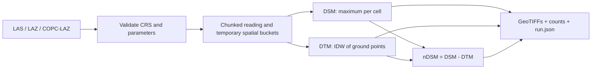

# lidar2DSM

Convert local **LAS, LAZ and COPC-LAZ files into DTM, DSM and nDSM GeoTIFFs**
with a shared grid, coverage reports and an explicit output resolution.
Python 3.12 or later. No services, authentication, database, PDAL or containers
are required; Docker is optional.

New to elevation models? Start with [Understanding DTM, DSM and nDSM](docs/surface_models.md).



## Installation

```powershell
python -m venv .venv
.venv\Scripts\python -m pip install -e ".[test]"
```

On Linux/macOS, use `.venv/bin/python`. This keeps the system Python unchanged.
To use the main dependency versions verified with Python 3.12, add
`-c constraints/python312.txt` to the installation command.

## First run

Generate a small synthetic example locally: ground at 25 m, roof at 29 m and
an expected height above ground of 4 m. No downloads are needed, and these
coordinates do not represent a real vertical datum.

```powershell
.venv\Scripts\python -m lidar2dsm demo --output work/demo
.venv\Scripts\python -m lidar2dsm validate work/demo/config.json
.venv\Scripts\python -m lidar2dsm run work/demo/config.json --output outputs/demo
```

Open `outputs/demo/dtm.tif`, `dsm.tif` or `ndsm.tif` in QGIS and review
`outputs/demo/run.json`. The DTM should contain 8 × 8 pixels at **0.5 m/pixel**,
all at 25 m. The nDSM should contain 16 cells at 4 m and 48 cells at 0 m.
Each execution requires a new output directory.

## Your own data

```json
{
  "inputs": ["../data/lidar"],
  "mode": "ndsm",
  "resolution_m": 0.5,
  "radius_m": 1.0,
  "ground_classes": [2],
  "vertical_reference": "unknown"
}
```

Save this as `examples/local.json`. Input paths are resolved relative to that
JSON file; directories are searched recursively. All files must share a
suitable projected CRS in metres, Z units in metres and a common vertical
reference. This tool does not reproject, convert elevations or classify ground:
a DTM requires points already classified as ground.

**The requested resolution is preserved**, including values below 1 m.
Pixel size does not guarantee matching accuracy or point density. DTM
interpolation is limited to `radius_m`; cells without support remain NoData.
DSM uses the maximum of points inside each cell, without spreading them by radius.

## Documentation

- [Understanding DTM, DSM and nDSM](docs/surface_models.md): a beginner's guide.
- [Documentation index](docs/index.md), [installation and Docker](docs/installation.md).
- [Configuration contract](docs/configuration.md) and [algorithms](docs/architecture.md).
- [Outputs and coverage](docs/outputs.md), [using the rasters](docs/raster_usage.md).
- [Example datasets](docs/example_catalog.md) and [limitations](docs/roadmap.md).
- [Tests](tests/README.md), [contributing](CONTRIBUTING.md), [dependencies](THIRD_PARTY.md).
- Agents: [AGENTS.md](AGENTS.md); Claude: [CLAUDE.md](CLAUDE.md).

## Verification

```powershell
.venv\Scripts\python -m pytest -q
.venv\Scripts\python -m pip wheel --no-deps . --wheel-dir dist
```

Tests check known elevations, IDW, 0.25/0.5/1/2 m resolutions, nDSM alignment,
window boundaries, filters, CRS handling and errors. The included CI runs on
Windows and Linux. See the [validation guide](docs/validation.md) for the scope
of those checks and separate real-data case studies.

## Author

[Francisco Rafael Moreno Santana](https://github.com/Fran-4c4)
