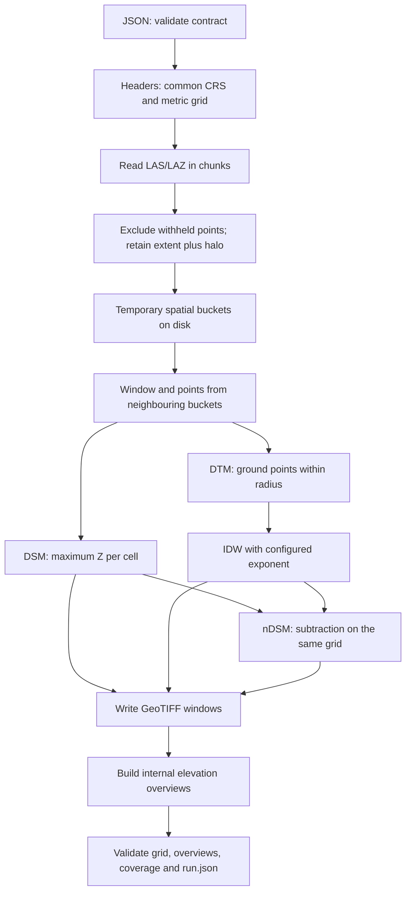

# Architecture and algorithms

The core reads LAS/LAZ through laspy, computes IDW with NumPy/SciPy and writes
GeoTIFFs with Rasterio. It does not wrap an external processing container or
require PDAL.

## Grid

The grid is anchored at `(0,0)` in the input CRS, north-up, with square pixels
of `resolution_m`. Automatic extents include points on header maxima; an extra
row or column may therefore appear at exact boundaries. Explicit `bounds` are
expanded outward to pixel multiples. Cells include their west/north edges and
exclude their east/south edges.

## DSM

Maximum Z of points **inside each cell**, after class filtering. A point is not
spread across several cells by a search radius. Cells without returns remain
NoData. This differs from radius-based maximum gridding in `PDAL writers.gdal`.

## DTM

Only `ground_classes` are used. All neighbours within horizontal distance
`radius_m` of each cell centre participate:

`Z = sum(Zi / di^p) / sum(1 / di^p)`.

If points lie exactly at the centre, their Z values are averaged and other
neighbours are ignored at that centre. No neighbours means NoData. Power and
radius are explicit. There is no automatic classification or subsequent gap
filling. A local origin is subtracted before distance calculations.

## nDSM

`DSM - DTM` where both are valid; otherwise NoData. Negative values are retained
for reviewing inconsistent sources, filtering or noise. A surface and terrain
from different acquisition dates can also produce real differences.

## Memory and disk

After the authoritative raster windows close, elevation products receive
power-of-two internal overviews down to the configured display target. Average
resampling reduces display noise while retaining broad slopes; it is never used
for analysis or written back into the base-resolution band. Count products do
not receive overviews because they have no single valid display aggregation.

Inputs are read in `chunk_points` batches. Temporary records store X/Y/Z/class
as float64 (32 bytes per retained point), plus in-memory indices and trees.
Each window loads its buckets and halo; `max_tile_points` prevents unbounded
growth. Neighbours are queried one centre at a time instead of building lists
for an entire window. These limits are safeguards, not exact RAM budgets.

Reducing `tile_pixels` reduces points per window. Increasing `radius_m` increases
cost and support. Partition changes must not introduce seams into the DTM.
Temporary buckets are removed even on failure; partial outputs remain marked
as `failed` in the manifest.

COPC is read sequentially as LAZ: this version **does not use its spatial index**.
A crop avoids rasterizing other areas but still reads the complete input file.
Full-survey performance remains to be measured.

During a run, wheels use their matching PROJ/GDAL databases and restore search
paths afterwards, avoiding conflicts with other GIS installations without
changing the user's environment. The PROJ search-path API is process-global:
do not call `run()` concurrently from multiple threads in one interpreter.
