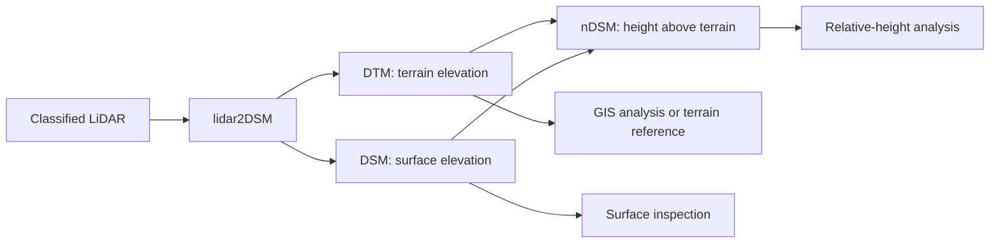

# Using the rasters

The interface to other software is a set of GeoTIFFs and an execution manifest.
No receiving application or checkout is required to generate these products.

## Terrain reference

Generate the DTM with verified ground classes and sufficient margins around the
area of interest. A crop limited to a feature boundary may prevent a receiving
tool from sampling unobstructed ground around it.

Review `ground_count`, `dtm_support` and `run.json` before using the DTM. Where
`ground_count=0`, valid DTM values come from neighbouring ground observations;
where `dtm_support=0`, the terrain is unknown and remains NoData.

## Coordinate compatibility

Combine rasters and other spatial data only after checking their horizontal CRS,
Z units and vertical basis. Deriving terrain from the same LiDAR preserves its
Z reference, but does not discover an absent datum or validate the ground
classification.

Surface elevation and terrain elevation must share a compatible vertical basis
to compute relative height. Placing data on a globe requires a separate, explicit
vertical-reference or placement procedure. This tool applies no hidden vertical
offset or ground-clamping operation.
