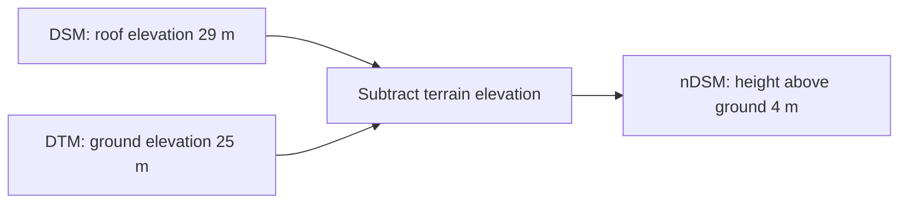

# Understanding DTM, DSM and nDSM

These three models describe different aspects of the same landscape. They are
usually stored as **rasters**: grids of cells, similar to image pixels. Instead
of storing a colour, each cell stores an elevation or a height.

| Model | Full name | What a cell describes | Typical uses |
|---|---|---|---|
| **DTM** | Digital Terrain Model | The elevation of the bare ground, without buildings or vegetation. | Terrain slopes, drainage analysis and a ground reference for measuring object heights. |
| **DSM** | Digital Surface Model | The elevation of the observed upper surface, including roofs and vegetation. | Inspecting the surface of a landscape, roofs or tree canopies. |
| **nDSM** | Normalized Digital Surface Model | The height of that surface above the local ground. | Estimating building or vegetation heights and finding objects that rise above the terrain. |

Terminology varies between data providers. This guide describes what these
names mean in lidar2DSM; another provider may use **DEM** (Digital Elevation
Model) as a broader term for elevation data.

## A simple example: a building

Imagine a building standing on ground at an elevation of **25 m**, with its
roof at **29 m**, both measured from the same vertical reference.

- **DTM = 25 m:** the ground beneath the building.
- **DSM = 29 m:** the top surface of its roof.
- **nDSM = 4 m:** the roof is four metres above the local ground.

The calculation is:

**nDSM = DSM − DTM = 29 m − 25 m = 4 m**

On nearby open, bare ground, both DSM and DTM might be about 25 m, giving an
nDSM close to **0 m**. Over a tree, DSM describes the observed vegetation
surface and nDSM estimates its height above the terrain.

The [included synthetic example](../README.md#first-run) uses these same ground
and roof elevations so that you can inspect the three products yourself.

## Elevation is different from height above ground

**Elevation** is measured from a vertical reference. That reference might be a
national height datum, an ellipsoid or an explicitly defined local reference;
it is not automatically sea level.

**Height above ground** is a local difference. A roof can have an elevation of
29 m while being only 4 m above the ground beneath it. On a hillside, two equally
tall buildings can have different roof elevations.

DSM and DTM must use compatible vertical references and units before they can
be subtracted. Subtracting metres from feet, or mixing different vertical datums,
does not produce a trustworthy object height. Assigning a horizontal CRS alone
does not resolve an unknown vertical reference.

## How do LiDAR points become these models?

LiDAR provides a **point cloud**: many measured positions with X, Y and Z
coordinates. Classified point clouds also label points as ground, vegetation,
buildings and other categories.

In this tool:

1. **DSM:** take the highest retained point inside each cell. By default all
   classes participate; you can restrict them with `dsm_classes`.
2. **DTM:** select points classified as ground, normally class 2, and estimate
   the elevation at each cell centre using nearby ground points. The method is
   IDW: closer points receive more weight than farther points.
3. **nDSM:** subtract DTM from DSM on exactly the same grid. Both values must
   exist for a cell to have a valid nDSM value.

lidar2DSM does not automatically classify the cloud. A point on a roof does not
become a ground observation simply because it is the lowest point available.

## What happens beneath a building or dense vegetation?

There may be no measured ground points beneath a roof. A DTM value there is
therefore often an **estimate from surrounding ground**, rather than a direct
measurement beneath the building. Vegetation can also reduce ground returns.

This version only estimates terrain where ground points are available within
the configured search radius. If there are none, the cell remains **NoData**.
It does not invent a continuous ground surface across an unsupported area.

Use the accompanying rasters to inspect this:

- `ground_count.tif`: how many ground records fall inside each cell.
- `dtm_support.tif`: how many ground neighbours support the DTM calculation at
  that cell centre.

A cell with no ground points inside it may still have an estimated DTM value
from nearby points. A cell with no DTM support has an unknown ground elevation.
Increasing the search radius may cover more cells, but can also smooth terrain
or mix observations from different sides of a slope or embankment.

## Does a 0.5 m pixel mean 0.5 m accuracy?

**No.** Pixel size describes the spacing of the output grid. A 0.5 m pixel
covers a 0.5 × 0.5 m area, so there are four cells per square metre.

Point density describes how many observations are available per area. For DTM,
the number of **ground points** matters, not just the total number of points.
Accuracy depends on measurement quality, classification, terrain, support and
the estimation method. A smaller pixel does not create new measurements or
guarantee better elevations.

## Reading the results safely

- **Zero is a value; NoData is an absence of information.** A valid nDSM of
  0 m can represent bare ground. NoData does not mean the terrain is at zero.
- A high DSM value is an elevation, not necessarily a tall object. Check the
  DTM before interpreting its height above ground.
- An nDSM is not automatically a clean building-height map: trees, noise and
  other surfaces can contribute. Filtering classes changes what it represents.
- Small negative nDSM values can occur because of interpolation, noise or
  inconsistent inputs. They are retained for review rather than silently set
  to zero.
- A completed conversion does not guarantee full coverage or survey accuracy.
  Check the coverage and warnings in `run.json` before using the results.

Next: [generate your first example](../README.md#first-run), review the
[output files](outputs.md), or read the [configuration contract](configuration.md).
